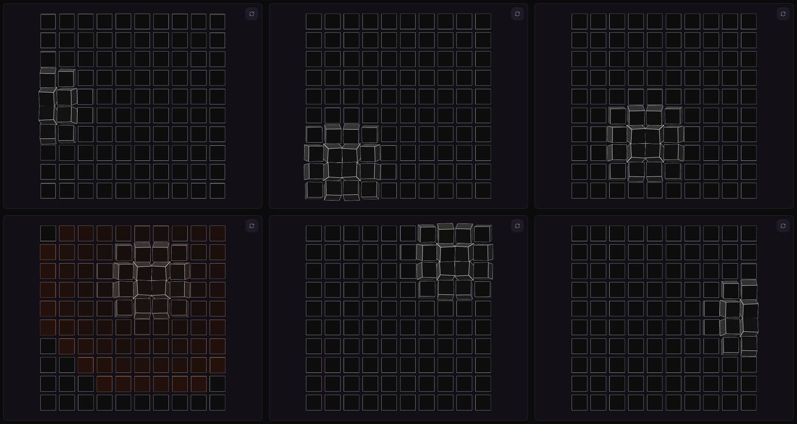
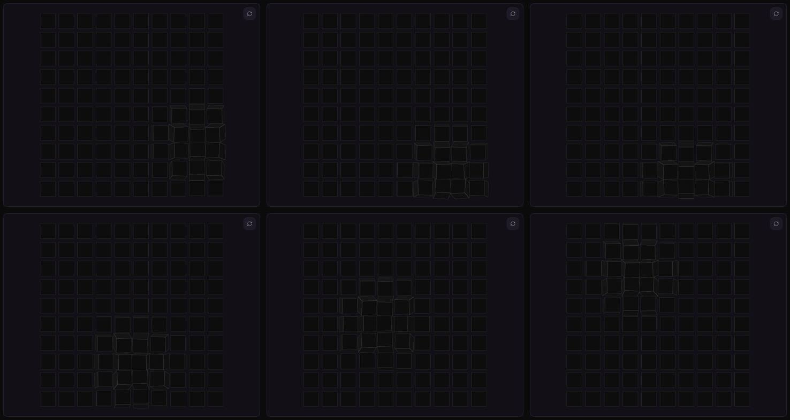
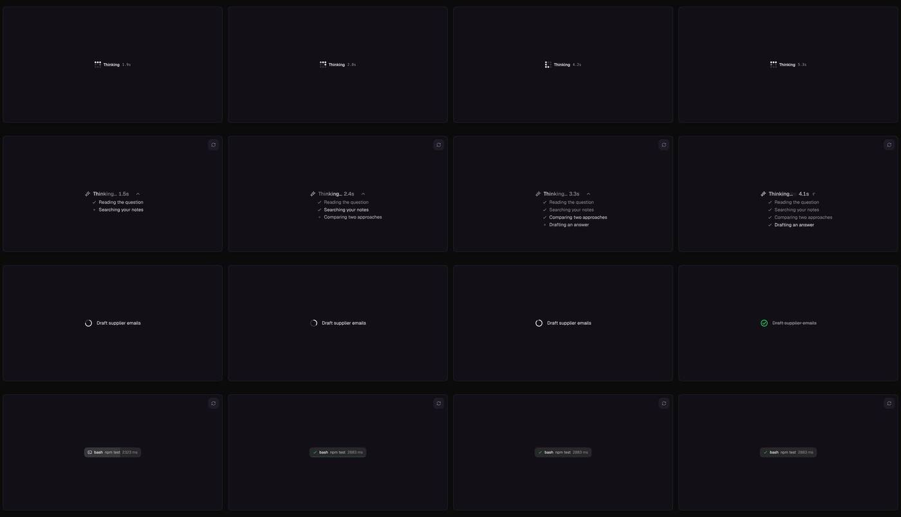
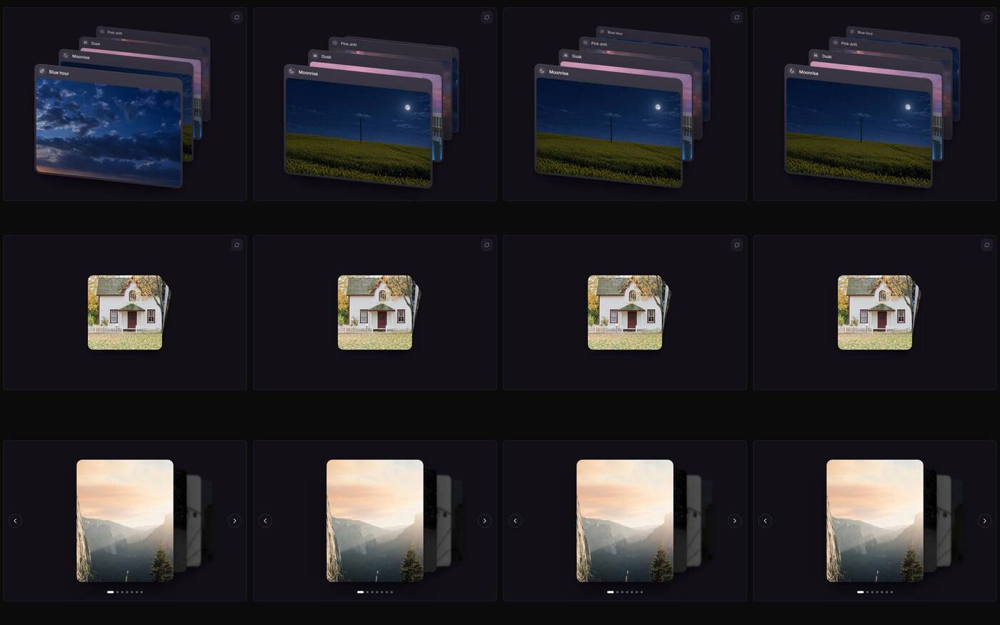
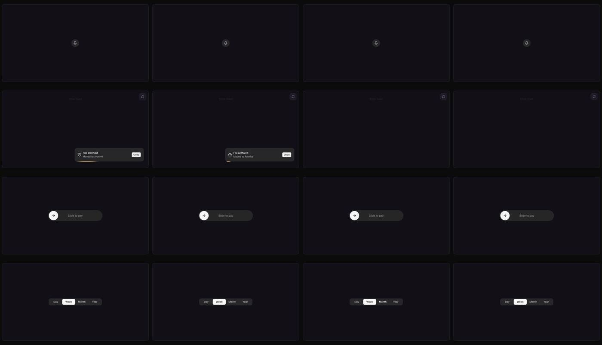
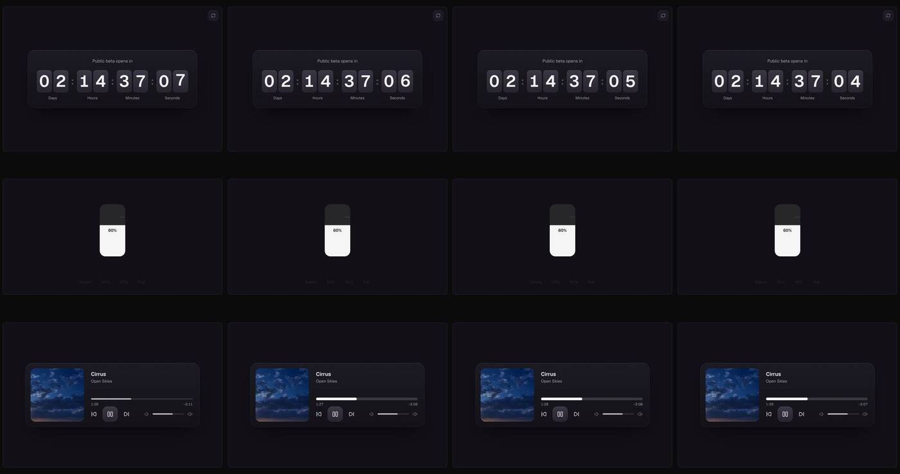
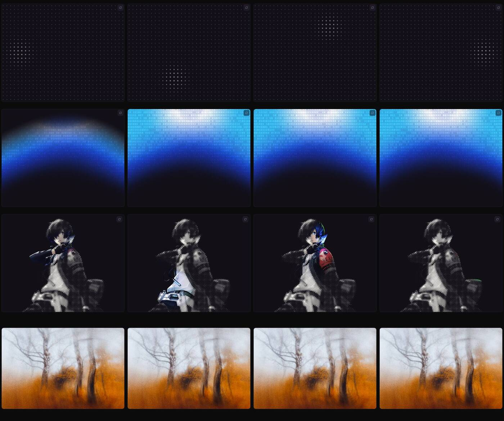

# React Bits — levantamento para a proposta interativa

> Batedor da biblioteca de componentes · 29/10/2026 · fontes: site https://reactbits.dev e repositório
> https://github.com/DavidHDev/react-bits (clone raso do `main`, commit `e12c221`, 19/10/2026).
> Nada foi instalado no app. Prints e quadros gravados com Playwright/Chromium em 1440×900.
> Estrutura de capítulos considerada: **nova espinha** "um problema do dia a dia por capítulo"
> (1 atendimento pela tela bloqueada → relatório · 2 contas pela foto do boleto · 3 WhatsApp com clientes ·
> 4 inteligência de dados sem jargão · abertura e fechamento) + elementos transversais.

## Resumo em 5 linhas

- **Licença: MIT + Commons Clause** — pode usar em produto/site comercial (inclusive pago); **não pode vender
  nem redistribuir os componentes em si** (sozinhos, em pacote ou portados). Para a proposta e para o sistema
  entregue à cliente: **permitido**. Manter o aviso de copyright nos arquivos copiados.
- 218 componentes no repositório (o site diz "217"/"215+"): Text Animations 33, Animations 38, Components 48,
  Micro 35, Backgrounds 64. 87 são WebGL. Todos os arquivos TS já começam com `'use client'`.
- Instalação = **código-fonte copiado para o projeto** (CLI shadcn ou jsrepo, ou copiar à mão). Para nós:
  variante **TS-CSS** (o app não usa Tailwind), via **jsrepo** ou cópia manual (o `shadcn add` exige
  `components.json`/init, que mexe no projeto).
- **Cubes** (pedido direto): serve, em **um** lugar — o bloco quadrado da abertura, com ripple vermelho Khard
  ao clicar "Começar" (e opcionalmente como "virada" curta entre capítulos). Não serve como grade de cartas do
  fechamento. Detalhes e ajustes obrigatórios na seção 3.1.
- React Bits **não tem** tela de bloqueio/celular nem gráficos. Tem as peças: VoicePill, SwipeToast,
  SlideCommit (celular), Stack (galeria de modelos), Counter/RubberSegment (dados), ThoughtLine/StatusMark (Donna).

---

## 1. Licença, instalação, variantes e dependências

### 1.1 Licença (fonte: `LICENSE.md` do repo; selo do README "MIT + Commons Clause")

Texto-chave, literal:

> Permission is hereby granted, free of charge … to use, copy, modify, merge, publish, and distribute the
> Software **as part of an application, website, or product** … The above copyright notice and this
> permission notice shall be included in all copies…
>
> **Commons Clause Restriction** — You may use this Software, including for any commercial purpose, **so long
> as you do not sell, sublicense, or redistribute the components themselves — whether alone, in a bundle, or as
> a ported version.**

O que isso significa para nós:

| Uso | Pode? |
|---|---|
| Usar na proposta (site privado da Khard para a cliente) | Sim |
| Usar no sistema que vendemos/entregamos à Dra. Gabriela (CRM, plataforma de cursos…) | Sim — é "parte de um produto" |
| Modificar à vontade (cores, props, trocar ícones) | Sim |
| Publicar um "kit Khard de componentes animados" / vender templates com esses componentes | **Não** |
| Portar para Vue/Svelte e distribuir | **Não** |
| Remover o aviso | **Não** — manter um comentário `// Based on React Bits (MIT + Commons Clause) © David Haz` no topo de cada arquivo copiado |
| Ferramentas (Background Studio, Texture Lab, Sound Lab…) | Exports podem ser usados em produto; não revender os exports como pacote |

Não é OSI "open source" puro; o jurídico deve saber que é *source-available* com restrição de revenda. Garantia: nenhuma ("AS IS").

### 1.2 Instalação (fonte: `src/docs/Installation.jsx` = https://reactbits.dev/get-started/installation)

"Every component installs as source code you own." Três caminhos, mesmo código:

```bash
# shadcn (registry @react-bits) — exige components.json (shadcn init), que altera o projeto
npx shadcn@latest add @react-bits/Cubes-TS-CSS

# jsrepo — recomendado para nós (não exige init do shadcn)
npx jsrepo@latest add https://reactbits.dev/r/Cubes-TS-CSS

# à mão — aba "Code" do site, ou do repo: src/ts-default/<Categoria>/<Nome>/<Nome>.tsx + .css
```

- **Variantes** (`VARIANTS` em `src/constants/Information.js`): `JS-CSS`, `JS-TW`, `TS-CSS`, `TS-TW`.
  No repo: `src/content` (JS-CSS), `src/tailwind` (JS-TW), `src/ts-default` (TS-CSS), `src/ts-tailwind` (TS-TW).
  **Usar `TS-CSS`** — nosso app é TS sem Tailwind.
- Há também um **MCP** (`npx shadcn@latest mcp init --client claude`) — dispensável; copiar é mais controlado.
- O manifesto de cada variante fica em `public/r/<Nome>-<VAR>.json` (campo `dependencies`), servido em
  `https://reactbits.dev/r/<Nome>-<VAR>.json`.

### 1.3 Dependências por componente (fonte: `public/r/*-TS-TW.json` + imports do código)

| Dependência | Quem usa | Já temos no app? |
|---|---|---|
| nenhuma (React puro / WebGL2 cru / canvas 2D) | a maioria — inclusive Cubes, Counter, DotGrid, Noise, GradualBlur, LatticeLoader, SloshGauge, quase todos os Backgrounds | — |
| `gsap@^3.13` (+ `@gsap/react`) | SplitText, TextType, ScrambledText, ScrollReveal, AnimatedContent, FadeContent, DepthCarousel, StaggeredMenu… | **Sim** (gsap 3.15, `@gsap/react` 2.1; `gsap/SplitText` presente) |
| `motion@^12` | BlurText, CountUp, Stack, StatusMark, RubberSegment, SlideCommit, ThoughtLine, WakeSlider, FlipCard… | **Sim** (motion 14.7, `motion/react` existe) — conferir com `tsc` |
| `@hugeicons/react` + `@hugeicons/core-free-icons` | VoicePill, SwipeToast, SlideCommit, CallChip, ThoughtLine, AnimatedList, CardSwap, Stepper, MagicBento, RefineFrame, PromptBar… | **Não — e não vamos instalar**: regra do repo é Tabler. Trocar os ícones por `@tabler/icons-react` ao copiar |
| `ogl` | PatternWaves, MorphSlider, FlexCarousel, WarpText, DitherVeil, CrystalizedBall, EvilEye… | Não |
| `three` / `@react-three/fiber` / `@react-three/drei` | ModelViewer (r3f+drei), Hyperspeed, ColorBends, Lanyard, BlobCursor, PaperCrumple | Não — evitar (peso) |
| `matter-js` | FallingText, FolderFloat | Não |
| `@use-gesture/react` | DomeGallery | Não |
| `vgpu` | ShapeWaves, AeroShards | Não |

`postprocessing` não aparece em nenhum componente atual.

Acessibilidade de movimento: 205 de 218 componentes tratam `prefers-reduced-motion` no código. **Exceções
relevantes para nós: SplitText, BlurText, CountUp e GradualBlur não tratam** — envolver com o nosso guard.

---

## 2. Catálogo por categoria

Gerado do `src/constants/Information.js` (descrições oficiais, em inglês) + imports de cada pasta.
"Render" = WebGL / canvas 2D / DOM-CSS detectado no código. `(+hugeicons)` = trocar por Tabler.
Candidatos olhados em quadros: Cubes, Counter, VoicePill, CallChip, LatticeLoader, ThoughtLine, StatusMark,
ElasticSlider, RubberSegment, SlideCommit, RefineFrame, GradientASCII, DotGrid, SplitText, BlurText,
AnimatedList, Particles, HalftoneReveal, DitherVeil, Noise, GradualBlur, TextType, CursorGrid, HoldButton,
Stepper, CardSwap, Stack, DepthCarousel, Folder, BounceCards, SwipeToast, SloshGauge, FlipCard.

#### Text Animations (33)

| Componente | O que faz (descrição oficial) | Deps npm | Render |
|---|---|---|---|
| [AsciiText](https://reactbits.dev/text-animations/ascii-text) | Waving ASCII text that tilts toward the pointer, scrambles on hover and ripples on click. | — | DOM/CSS |
| [BlurText](https://reactbits.dev/text-animations/blur-text) | Text starts blurred then crisply resolves for a soft-focus reveal effect. | motion | DOM/CSS |
| [CircularText](https://reactbits.dev/text-animations/circular-text) | Layouts characters around a circle with optional rotation animation. | motion | DOM/CSS |
| [CountUp](https://reactbits.dev/text-animations/count-up) | Animated number counter supporting formatting and decimals. | motion | DOM/CSS |
| [CurvedLoop](https://reactbits.dev/text-animations/curved-loop) | Flowing looping text path along a customizable curve with drag interaction. | — | DOM/CSS |
| [DecryptedText](https://reactbits.dev/text-animations/decrypted-text) | Hacker-style decryption cycling random glyphs until resolving to real text. | motion | canvas 2D |
| [DepthText](https://reactbits.dev/text-animations/depth-text) | Layered extruded type with parallax that shifts against the pointer. | — | DOM/CSS |
| [EchoText](https://reactbits.dev/text-animations/echo-text) | Ghosted copies trail behind the text and settle into a single word. | — | DOM/CSS |
| [FallingText](https://reactbits.dev/text-animations/falling-text) | Text that breaks apart and tumbles into a pile you can drag, throw and swipe, then flies back into place. | matter-js | DOM/CSS |
| [FoldText](https://reactbits.dev/text-animations/fold-text) | Lines unfold into place like creased paper opening flat. | gsap | DOM/CSS |
| [FuzzyText](https://reactbits.dev/text-animations/fuzzy-text) | Vibrating fuzzy text with controllable hover intensity. | — | canvas 2D |
| [GlitchText](https://reactbits.dev/text-animations/glitch-text) | RGB split and distortion glitch effect with jitter effects. | — | DOM/CSS |
| [GradientText](https://reactbits.dev/text-animations/gradient-text) | Living gradients inside your text: a sliding sweep, a drifting mesh or a swinging conic fan. | — | DOM/CSS |
| [MaskedHeading](https://reactbits.dev/text-animations/masked-heading) | A headline with a drifting colour mesh or image showing through, revealed word by word. | gsap | DOM/CSS |
| [ParticleText](https://reactbits.dev/text-animations/particle-text) | Text assembles from drifting particles that scatter and reform on demand. | — | canvas 2D |
| [RotatingText](https://reactbits.dev/text-animations/rotating-text) | Cycles through multiple phrases with 3D rotate / flip transitions. | motion | DOM/CSS |
| [ScrambledText](https://reactbits.dev/text-animations/scrambled-text) | Detects cursor position and applies a distortion effect to text. | gsap | DOM/CSS |
| [ScrollFloat](https://reactbits.dev/text-animations/scroll-float) | Text gently floats / parallax shifts on scroll. | gsap | DOM/CSS |
| [ScrollReveal](https://reactbits.dev/text-animations/scroll-reveal) | Text gently unblurs and reveals on scroll. | gsap | DOM/CSS |
| [ScrollVelocity](https://reactbits.dev/text-animations/scroll-velocity) | Text marquee animatio - speed and distortion scale with user's scroll velocity. | motion | DOM/CSS |
| [ShinyText](https://reactbits.dev/text-animations/shiny-text) | A sheen of light that sweeps across text, from soft bands to chrome-like reflections. | — | canvas 2D |
| [Shuffle](https://reactbits.dev/text-animations/shuffle) | Animated text reveal where characters shuffle before settling. | @gsap/react, gsap | canvas 2D |
| [SplitFlapText](https://reactbits.dev/text-animations/split-flap-text) | Mechanical split-flap departure board that clacks through to each new phrase. | — | DOM/CSS |
| [SplitText](https://reactbits.dev/text-animations/split-text) | Splits text into characters / words for staggered entrance animation. | @gsap/react, gsap | DOM/CSS |
| [StrokeText](https://reactbits.dev/text-animations/stroke-text) | Outlined letterforms draw themselves on, then flood with fill. | gsap | DOM/CSS |
| [TechText](https://reactbits.dev/text-animations/tech-text) | A wordmark whose letters turn into dashed vector paths under the cursor. | — | canvas 2D |
| [TextCursor](https://reactbits.dev/text-animations/text-cursor) | Text or emoji that trails your cursor as stamped copies, a following chain or a ribbon of letters. | — | DOM/CSS |
| [TextLoop](https://reactbits.dev/text-animations/text-loop) | A seamless text marquee that flows along curved SVG paths. | gsap | DOM/CSS |
| [TextPressure](https://reactbits.dev/text-animations/text-pressure) | Characters scale / warp interactively based on pointer pressure zone. | — | DOM/CSS |
| [TextType](https://reactbits.dev/text-animations/text-type) | Typewriter effect with blinking cursor and adjustable typing cadence. | gsap | DOM/CSS |
| [TrueFocus](https://reactbits.dev/text-animations/true-focus) | Applies dynamic blur / clarity based over a series of words in order. | motion | DOM/CSS |
| [VariableProximity](https://reactbits.dev/text-animations/variable-proximity) | Letter styling changes continuously with pointer distance mapping. | — | DOM/CSS |
| [WarpText](https://reactbits.dev/text-animations/warp-text) | WebGL warp that bends and refracts the text around the pointer. | ogl | canvas 2D |

#### Animations (38)

| Componente | O que faz (descrição oficial) | Deps npm | Render |
|---|---|---|---|
| [AnimatedContent](https://reactbits.dev/animations/animated-content) | Wrapper that reveals its content on scroll with slides, blur, 3D tilts, soft wipes and staggered children. | gsap | DOM/CSS |
| [BlobCursor](https://reactbits.dev/animations/blob-cursor) | Liquid metal blob cursor that stretches, sloshes and bursts into droplets, in chrome, jelly, pearl or ink. | three | DOM/CSS |
| [ClickSpark](https://reactbits.dev/animations/click-spark) | Bursts of sparks at every click, as dashes, comets, dots or stars, that can spill around buttons. | — | canvas 2D |
| [Crosshair](https://reactbits.dev/animations/crosshair) | Crosshair cursor with live coordinates that locks onto links and buttons and measures them. | — | canvas 2D |
| [CrystalizedBall](https://reactbits.dev/animations/crystalized-ball) | A glass ball with a crackling electric rim and glowing dust that swirls with the cursor. | ogl | canvas 2D |
| [Cubes](https://reactbits.dev/animations/cubes) | A grid of outlined 3D cubes that turn to face the cursor, spin when swept and ripple on click. | — | WebGL |
| [CursorGrid](https://reactbits.dev/animations/cursor-grid) | A crisp grid whose cells light up and fade behind the cursor, with grid styles, tiles and click pulses. | — | WebGL |
| [DitherVeil](https://reactbits.dev/animations/dither-veil) | A 1-bit dithered photo the cursor burns through to full colour, knitting back cell by cell. | ogl | canvas 2D |
| [ElasticMesh](https://reactbits.dev/animations/elastic-mesh) | Turns text or any logo into a puffy inflated shape you can press, poke and stretch like jelly. | — | WebGL |
| [ElectricBorder](https://reactbits.dev/animations/electric-border) | Wraps any element in crackling strands of current that surge near the cursor and leap off in sparks. | — | WebGL |
| [ElectricLogo](https://reactbits.dev/animations/electric-logo) | Turns any logo into a living lightning outline, with arcs that leap off its edges. | ogl | canvas 2D |
| [FadeContent](https://reactbits.dev/animations/fade-content) | Wrapper that fades content in on scroll, plain or out of focus, from washed-out gray, or through grain, mist and pixel blocks. | gsap | DOM/CSS |
| [GhostCursor](https://reactbits.dev/animations/ghost-cursor) | A ghost of glowing smoke that floats after the cursor and curls away as it rises. | — | WebGL |
| [GlareHover](https://reactbits.dev/animations/glare-hover) | A glossy light streak that sweeps across any element in the direction the cursor moves. | — | DOM/CSS |
| [GlowCursor](https://reactbits.dev/animations/glow-cursor) | Light that pours from the cursor, drifts softly through the air and cools as it fades. | — | WebGL |
| [GradualBlur](https://reactbits.dev/animations/gradual-blur) | Progressive edge blur for headers, footers, captions and carousels, with an optional fade to color that hides at the ends of a scroll. | — | DOM/CSS |
| [HalftoneReveal](https://reactbits.dev/animations/halftone-reveal) | A halftone print of an image whose dots swell into the real photo under the cursor. | — | WebGL |
| [ImageTrail](https://reactbits.dev/animations/image-trail) | Cursor-based image trail with several built-in variants. | gsap | DOM/CSS |
| [LaserFlow](https://reactbits.dev/animations/laser-flow) | A beam of light that splashes onto your content and pours over its corners. | — | WebGL |
| [LogoLoop](https://reactbits.dev/animations/logo-loop) | Continuously looping marquee of brand or tech logos with seamless repeat and hover pause. | — | DOM/CSS |
| [Magnet](https://reactbits.dev/animations/magnet) | Elements magnetically ease toward the cursor then settle back with spring physics. | — | DOM/CSS |
| [MetaBalls](https://reactbits.dev/animations/meta-balls) | Liquid metaballs that merge, stretch and pinch apart, with a cursor blob that pushes through them. | — | WebGL |
| [MetallicPaint](https://reactbits.dev/animations/metallic-paint) | Liquid chrome that flows over your logo or text, adapted from Paper's Liquid Metal shader. | — | WebGL |
| [Noise](https://reactbits.dev/animations/noise) | Film grain overlay for photos and pages, from fine 35mm grain to dust, paper and TV static. | — | canvas 2D |
| [OrbitImages](https://reactbits.dev/animations/orbit-images) | SVG Path customizable orbiting images effect | — | DOM/CSS |
| [PixelSwap](https://reactbits.dev/animations/pixel-swap) | New content builds in pixel by pixel in a springy wave that starts wherever the cursor enters. | — | DOM/CSS |
| [PixelTrail](https://reactbits.dev/animations/pixel-trail) | Glossy pixels melt into a fluid goo trail behind the cursor, with color shifts and drips. | — | WebGL |
| [PixelTransition](https://reactbits.dev/animations/pixel-transition) | Retro pixel dissolve that covers a card in solid pixels, swaps the content underneath and clears again. | — | canvas 2D |
| [Ribbons](https://reactbits.dev/animations/ribbons) | Springy ribbons that trail the cursor, in lens, comet or even shapes with an optional wave. | — | WebGL |
| [RippleDistortion](https://reactbits.dev/animations/ripple-distortion) | Pointer-driven water displacement that warps content and leaves a decaying wake. | ogl | DOM/CSS |
| [ScrollExpand](https://reactbits.dev/animations/scroll-expand) | A rounded media frame that grows to full bleed as it scrolls through the viewport. | — | DOM/CSS |
| [ShapeBlur](https://reactbits.dev/animations/shape-blur) | A crisp logo or shape that drifts out of focus under the pointer like a camera lens. | — | WebGL |
| [SplashCursor](https://reactbits.dev/animations/splash-cursor) | A fluid simulation that trails the cursor in swirling ink and bursts into a splash on click. | — | WebGL |
| [StarBorder](https://reactbits.dev/animations/star-border) | A twinkling star that travels the exact outline of any button, pill or card, trailing light and stardust. | — | canvas 2D |
| [StickerPeel](https://reactbits.dev/animations/sticker-peel) | A die-cut sticker you can peel at any edge, drag, throw and swing, in gloss, matte or holographic finishes. | — | WebGL |
| [Strands](https://reactbits.dev/animations/strands) | Spectral strands that twist inside a frosted glass orb and swell into a smooth bulge where they come together, like the new Siri. | — | WebGL |
| [SwarmCursor](https://reactbits.dev/animations/swarm-cursor) | A liquid swarm of particles that flows after the cursor, curls into eddies and pours around hovered buttons. | — | WebGL |
| [TargetCursor](https://reactbits.dev/animations/target-cursor) | A reticle cursor whose corner brackets snap around targets, matching their shape. | — | DOM/CSS |

#### Components (48)

| Componente | O que faz (descrição oficial) | Deps npm | Render |
|---|---|---|---|
| [AccordionGallery](https://reactbits.dev/components/accordion-gallery) | Panels expand on hover or focus, revealing parallax imagery and captions. | gsap | DOM/CSS |
| [AnimatedList](https://reactbits.dev/components/animated-list) | A scrolling list whose rows spring into view, with a gliding selection and arrow keys. | — (+hugeicons) | DOM/CSS |
| [BorderGlow](https://reactbits.dev/components/border-glow) | Glowing mesh-gradient border that follows cursor direction and intensifies near edges. | — | DOM/CSS |
| [BounceCards](https://reactbits.dev/components/bounce-cards) | A fan of photo cards that bounce in, then spread apart and straighten the one you hover. | — | DOM/CSS |
| [BubbleMenu](https://reactbits.dev/components/bubble-menu) | Floating circular expanding menu with staggered item reveal. | gsap | DOM/CSS |
| [CardNav](https://reactbits.dev/components/card-nav) | A navigation bar that springs open into a row of cards, each with its own links. | — (+hugeicons) | DOM/CSS |
| [CardSwap](https://reactbits.dev/components/card-swap) | A 3D stack of cards that sends the front card to the back on a timer, or when you fling it. | — (+hugeicons) | DOM/CSS |
| [Carousel](https://reactbits.dev/components/carousel) | Swipeable cards for feature tours, stories and galleries, with five transitions and an autoplay timer. | — (+hugeicons) | DOM/CSS |
| [ChromaGrid](https://reactbits.dev/components/chroma-grid) | A grid of grayscale photo cards where a spotlight follows the cursor and brings back color. | — | DOM/CSS |
| [CircularCarousel](https://reactbits.dev/components/circular-carousel) | A 3D ring of images with bendable cards, momentum drag, snapping and click to focus. | — | DOM/CSS |
| [CircularGallery](https://reactbits.dev/components/circular-gallery) | A curved image gallery you can drag, scroll or tab through, with cards that open to the full image. | — | WebGL |
| [Counter](https://reactbits.dev/components/counter) | An odometer-style number whose digits roll to every new value, with currency, separators and locales. | — | DOM/CSS |
| [CurvedInput](https://reactbits.dev/components/curved-input) | Arc-bent input bar with text, caret and submit button all following the curve. | — | DOM/CSS |
| [DecayCard](https://reactbits.dev/components/decay-card) | An image card that tears and melts as the pointer moves, then pulls itself back together. | — | WebGL |
| [DepthCarousel](https://reactbits.dev/components/depth-carousel) | Cards recede into depth on a 3D rail, with drag, keyboard and auto-advance. | gsap | DOM/CSS |
| [Dock](https://reactbits.dev/components/dock) | macOS style dock with smooth magnification, launch bounce, badges and context menus. | — | DOM/CSS |
| [DomeGallery](https://reactbits.dev/components/dome-gallery) | Immersive 3D dome gallery projecting images on a hemispheric surface. | @use-gesture/react | DOM/CSS |
| [DriftWall](https://reactbits.dev/components/drift-wall) | An endless perspective wall of tiles drifting past, lifting on hover. | — | DOM/CSS |
| [ElasticSlider](https://reactbits.dev/components/elastic-slider) | A slider that grows under your cursor and stretches like rubber when pulled past either end, then springs back. | — (+hugeicons) | canvas 2D |
| [FlexCarousel](https://reactbits.dev/components/flex-carousel) | An infinite image row that flows through invisible liquid glass at its edges. | ogl | canvas 2D |
| [FlowingMenu](https://reactbits.dev/components/flowing-menu) | A full-height menu with a liquid band that glides between rows and reveals a scrolling marquee of each item. | — (+hugeicons) | DOM/CSS |
| [FluidGlass](https://reactbits.dev/components/fluid-glass) | A 3D glass object that refracts your headline, image or video, follows the cursor and melts between shapes. | — | WebGL |
| [FlyingPosters](https://reactbits.dev/components/flying-posters) | 3D posters that twist and flip as you scroll or drag through an endless column. | — | WebGL |
| [Folder](https://reactbits.dev/components/folder) | Folder that drops its flap open or swings open like a book, with pages you can pick. | — | WebGL |
| [GlassIcons](https://reactbits.dev/components/glass-icons) | Liquid glass icons that bend the color behind them, for app grids, docks and social links. | — | WebGL |
| [GlassSurface](https://reactbits.dev/components/glass-surface) | Apple-style liquid glass that bends what is behind it, in a rounded panel or any logo shape. | — | WebGL |
| [GooeyNav](https://reactbits.dev/components/gooey-nav) | A navigation bar whose active pill breaks into goo that flows over to the item you pick. | — | WebGL |
| [HoloCard](https://reactbits.dev/components/holo-card) | Collectible trading card with a real holographic foil and glitter that sparkles as it tilts. | — | WebGL |
| [InfiniteMenu](https://reactbits.dev/components/infinite-menu) | A draggable sphere of image tiles that snaps the nearest one forward and shows its title. | — | WebGL |
| [InfiniteSpiral](https://reactbits.dev/components/infinite-spiral) | An endlessly looping 3D helix of images with adjustable motion, depth and spacing. | — | DOM/CSS |
| [Lanyard](https://reactbits.dev/components/lanyard) | Swinging 3D badge on a stretchy woven band that you can drag, throw or click to flip. | three | canvas 2D |
| [LineSidebar](https://reactbits.dev/components/line-sidebar) | Static list navigation with a cursor-proximity effect that shifts and highlights nearby items. | — | DOM/CSS |
| [MagicBento](https://reactbits.dev/components/magic-bento) | A bento grid of feature cards with live artwork, edge light that follows the cursor and a click wave. | — (+hugeicons) | canvas 2D |
| [Masonry](https://reactbits.dev/components/masonry) | A masonry gallery that springs into place, reflows as it resizes and opens images in a lightbox. | — (+hugeicons) | DOM/CSS |
| [ModelViewer](https://reactbits.dev/components/model-viewer) | A product-style 3D model viewer that frames itself and floats over a soft shadow. | @react-three/drei, @react-three/fiber, three | DOM/CSS |
| [MorphSlider](https://reactbits.dev/components/morph-slider) | WebGL slider that melts between images with a displacement transition. | gsap, ogl | DOM/CSS |
| [OptionWheel](https://reactbits.dev/components/option-wheel) | Curved option picker that spins with scroll, drag or arrow keys, tilting items away. | — | DOM/CSS |
| [PillNav](https://reactbits.dev/components/pill-nav) | A pill navigation bar where a fill rises through each link as its label rolls over, with a sliding active dot. | — | DOM/CSS |
| [PixelCard](https://reactbits.dev/components/pixel-card) | A card that fills with twinkling pixels on hover, rippling out from the center or the cursor. | — | canvas 2D |
| [ProfileCard](https://reactbits.dev/components/profile-card) | A framed profile card that tilts toward the cursor, with holographic foil shining through a tiled pattern. | — (+hugeicons) | DOM/CSS |
| [ReflectiveCard](https://reactbits.dev/components/reflective-card) | A metal ID card that reflects your camera or a looping video and catches the light as it tilts. | — (+hugeicons) | WebGL |
| [ScrollStack](https://reactbits.dev/components/scroll-stack) | Cards pin and stack as you scroll, settling back into a dimmed deck with smooth, jitter-free motion. | — | DOM/CSS |
| [SpecularButton](https://reactbits.dev/components/specular-button) | Glass button whose edge catches the light, with a highlight that glides toward the cursor. | — | WebGL |
| [SpotlightCard](https://reactbits.dev/components/spotlight-card) | Card lit by a soft spotlight that follows the pointer, catches its edge and reaches nearby cards. | — | DOM/CSS |
| [Stack](https://reactbits.dev/components/stack) | Pile of cards you can drag, flick or click through, with thrown cards tucking underneath. | motion | DOM/CSS |
| [StaggeredMenu](https://reactbits.dev/components/staggered-menu) | Menu with staggered item animations and smooth transitions on open/close. | gsap | DOM/CSS |
| [Stepper](https://reactbits.dev/components/stepper) | A multi-step flow with a gliding step indicator, spring transitions and horizontal or vertical layouts. | — (+hugeicons) | DOM/CSS |
| [TiltedCard](https://reactbits.dev/components/tilted-card) | A 3D card that tilts toward the cursor, with glare, a soft shadow, floating layers and a flip side. | — | DOM/CSS |

#### Micro (35)

| Componente | O que faz (descrição oficial) | Deps npm | Render |
|---|---|---|---|
| [BellToggle](https://reactbits.dev/micro/bell-toggle) | Pill toggle where a press rings the bell, crossfades the label and unfurls the pill. | motion (+hugeicons) | DOM/CSS |
| [BranchedMenu](https://reactbits.dev/micro/branched-menu) | Collapsible menu that branches each section from a trunk and traces a line to your pick. | — (+hugeicons) | DOM/CSS |
| [CallChip](https://reactbits.dev/micro/call-chip) | Tool-call chip whose fill wipes across as a live timer ticks, ending green or shaking red. | — (+hugeicons) | DOM/CSS |
| [CodeSlots](https://reactbits.dev/micro/code-slots) | One-time code input whose digits spring into their slots, with paste and SMS autofill. | motion (+hugeicons) | DOM/CSS |
| [CometDial](https://reactbits.dev/micro/comet-dial) | Tick-ring dial you flick by angle, with a comet that streaks behind the lit head. | motion | DOM/CSS |
| [DodgeField](https://reactbits.dev/micro/dodge-field) | Wrapper that makes any child dodge the pointer until it relents and glides home. | motion | DOM/CSS |
| [FlipCard](https://reactbits.dev/micro/flip-card) | Two-faced card that flips in 3D on a click, drag or flick and settles on a spring. | motion | DOM/CSS |
| [FlyingButton](https://reactbits.dev/micro/flying-button) | Button that fires its thrusters on hover, lifts off on a WebGL smoke plume and lands back in its own cloud. | — | WebGL |
| [FolderFloat](https://reactbits.dev/micro/folder-float) | Folder whose notes spring out into a floating cloud when it opens on hover or press. | matter-js | DOM/CSS |
| [FuseButton](https://reactbits.dev/micro/fuse-button) | Action button whose done state carries an undo on a burning fuse. | — (+hugeicons) | DOM/CSS |
| [GlideSelect](https://reactbits.dev/micro/glide-select) | Select chip whose menu pops from its corner and whose highlight glides between rows. | — (+hugeicons) | DOM/CSS |
| [HoldButton](https://reactbits.dev/micro/hold-button) | Hold-to-confirm button whose liquid fill rises while pressed and snaps back if you let go. | — | DOM/CSS |
| [JellyRadio](https://reactbits.dev/micro/jelly-radio) | Radio group of chips where the chosen one swells and barges its neighbours outward. | motion | DOM/CSS |
| [LatticeLoader](https://reactbits.dev/micro/lattice-loader) | Agent status row with a lattice of cells that brighten in a wave beside a live stopwatch. | — | DOM/CSS |
| [PaperCrumple](https://reactbits.dev/micro/paper-crumple) | An image that crumples into a textured 3D sheet while you hold and drag it. | three | DOM/CSS |
| [PeekRating](https://reactbits.dev/micro/peek-rating) | Star rating that lifts a wave of stars up to the pointer, then commits with a pop on click. | — (+hugeicons) | DOM/CSS |
| [PromptBar](https://reactbits.dev/micro/prompt-bar) | Chat composer with @ sources, / commands, a model picker, dictation and attachments. | motion (+hugeicons) | canvas 2D |
| [PulseHeart](https://reactbits.dev/micro/pulse-heart) | Like button that contracts to a dot, flips colour and pulses back as the count ticks over. | — (+hugeicons) | DOM/CSS |
| [RefineFrame](https://reactbits.dev/micro/refine-frame) | Media frame that steps an image through generation stages without any layout shift. | — (+hugeicons) | canvas 2D |
| [RubberSegment](https://reactbits.dev/micro/rubber-segment) | Segmented control whose rubber thumb stretches across the gap and squashes into place. | motion | DOM/CSS |
| [ScrubField](https://reactbits.dev/micro/scrub-field) | Number chip you drag to scrub, with rubber-band limits and click to type. | motion | DOM/CSS |
| [Shredder](https://reactbits.dev/micro/shredder) | A list with a paper shredder at the bottom that cuts dragged rows into curling strips. | — | canvas 2D |
| [SlideCommit](https://reactbits.dev/micro/slide-commit) | Slide-to-confirm handle that spins while your action runs and unfurls into a done pill. | motion (+hugeicons) | DOM/CSS |
| [SlingButton](https://reactbits.dev/micro/sling-button) | Send button you pull back like a slingshot and release to fire. | motion (+hugeicons) | DOM/CSS |
| [SloshGauge](https://reactbits.dev/micro/slosh-gauge) | Tank gauge whose liquid chases the value, tilts as it moves and splashes when it fills. | — | DOM/CSS |
| [SpringCheck](https://reactbits.dev/micro/spring-check) | Checkbox row where one spring fills the box, draws the tick and strikes through the label. | motion (+hugeicons) | DOM/CSS |
| [SquishSwitch](https://reactbits.dev/micro/squish-switch) | Switch whose thumb stretches with speed and squashes against the end when you flick it. | motion | DOM/CSS |
| [StatusMark](https://reactbits.dev/micro/status-mark) | Agent task status glyph that morphs from an idle ring to a progress arc, then a check. | motion | DOM/CSS |
| [SwipeRow](https://reactbits.dev/micro/swipe-row) | List row that swipes open to reveal actions and deletes on a full swipe. | motion (+hugeicons) | DOM/CSS |
| [SwipeToast](https://reactbits.dev/micro/swipe-toast) | Toast that swipes down to dismiss and burns a thin fuse for its remaining time. | motion (+hugeicons) | DOM/CSS |
| [TearTicket](https://reactbits.dev/micro/tear-ticket) | Ticket whose perforated stub tears off by hand, fibre by fibre, and drops away. | motion | DOM/CSS |
| [ThoughtLine](https://reactbits.dev/micro/thought-line) | Reasoning trace header with a live clock that folds its steps into one line when done. | motion (+hugeicons) | DOM/CSS |
| [VoicePill](https://reactbits.dev/micro/voice-pill) | Mic button that swells into a capsule of live equalizer bars and a timer while recording. | — (+hugeicons) | canvas 2D |
| [WakeSlider](https://reactbits.dev/micro/wake-slider) | Thumbless range slider of thin bars where drag speed raises a wake behind the handle. | motion | DOM/CSS |
| [WarmTooltip](https://reactbits.dev/micro/warm-tooltip) | Tooltip group where the first label waits, then its siblings open instantly while warm. | motion | DOM/CSS |

#### Backgrounds (64)

| Componente | O que faz (descrição oficial) | Deps npm | Render |
|---|---|---|---|
| [AcidSquares](https://reactbits.dev/backgrounds/acid-squares) | A rolling field of glossy squares that ripples under two drifting colored lights. | — | WebGL |
| [AeroShards](https://reactbits.dev/backgrounds/aero-shards) | Silk ribbons of thick glass shards streaming on layered depths among survey markers, catching light along their edges. | vgpu | canvas 2D |
| [Antigravity](https://reactbits.dev/backgrounds/antigravity) | A field of particles that lifts into a glowing ring around the cursor and bursts outward on click. | — | WebGL |
| [Aurora](https://reactbits.dev/backgrounds/aurora) | A soft, calm aurora that flows across the top of the page and drifts toward the cursor. | — | WebGL |
| [Balatro](https://reactbits.dev/backgrounds/balatro) | The swirling Balatro paint shader, with crisp pixels, a cursor that stirs the paint and click whirlpools. | — | WebGL |
| [Ballpit](https://reactbits.dev/backgrounds/ballpit) | A soft-lit pit of physics balls you can shove with the cursor, grab, throw and blast apart. | — | WebGL |
| [Beams](https://reactbits.dev/backgrounds/beams) | Glossy ribbons that ripple in the dark and catch the light, which follows your cursor. | — | WebGL |
| [CRTWarp](https://reactbits.dev/backgrounds/crt-warp) | A blocky plasma glowing on a curved CRT, with real scanlines, a phosphor mask, afterglow and a power-on intro. | — | WebGL |
| [ColorBends](https://reactbits.dev/backgrounds/color-bends) | Vibrant color bends with smooth flowing animation. | three | DOM/CSS |
| [DarkVeil](https://reactbits.dev/backgrounds/dark-veil) | A silky veil of light that drifts in the dark and bends around the cursor. | — | WebGL |
| [Dither](https://reactbits.dev/backgrounds/dither) | Retro dithered waves with Bayer, halftone, line and noise patterns, palettes and cursor trails. | — | WebGL |
| [DotField](https://reactbits.dev/backgrounds/dot-field) | A gradient dot field seen through a lens that follows the cursor, magnifying, pinching or swirling the dots. | — | WebGL |
| [DotGrid](https://reactbits.dev/backgrounds/dot-grid) | A springy dot grid that the cursor flicks and drags through like jelly, with click shockwaves. | — | WebGL |
| [EvilEye](https://reactbits.dev/backgrounds/evil-eye) | Procedural evil eye shader with animated iris, slit pupil, and fiery outer glow. | ogl | DOM/CSS |
| [FaultyTerminal](https://reactbits.dev/backgrounds/faulty-terminal) | A flickering CRT terminal of glowing glyphs, with phosphor trails under the cursor and glitches on click. | — | WebGL |
| [Ferrofluid](https://reactbits.dev/backgrounds/ferrofluid) | A glossy sea of magnetic fluid where swells of spikes roll in and the cursor raises a crown. | — | WebGL |
| [FloatingLines](https://reactbits.dev/backgrounds/floating-lines) | Ribbons of fine glowing lines that drift in waves, part around the cursor and curl when clicked. | — | WebGL |
| [FluxLines](https://reactbits.dev/backgrounds/flux-lines) | Glowing flux lines tracing a churning magnetic fluid. The cursor magnet reveals and curls them. | — | WebGL |
| [Galaxy](https://reactbits.dev/backgrounds/galaxy) | Endless flight through a twinkling starfield with warp jumps, cursor repulsion and star palettes. | — | WebGL |
| [GhostFibers](https://reactbits.dev/backgrounds/ghost-fibers) | Layered ribbons of fine glowing fibers that twist, fold and drift through soft depth of field. | — | WebGL |
| [GradientASCII](https://reactbits.dev/backgrounds/gradient-ascii) | Soft gradient glows drawn in ASCII characters that scramble under the cursor. | — | WebGL |
| [GradientBlinds](https://reactbits.dev/backgrounds/gradient-blinds) | Satin gradient blinds lit by a spotlight that follows the cursor, swaying and turning toward the light. | — | WebGL |
| [GradientWaves](https://reactbits.dev/backgrounds/gradient-waves) | Lit satin waves rolling in from a hazy horizon, with a light that follows the cursor and swells on click. | — | WebGL |
| [Grainient](https://reactbits.dev/backgrounds/grainient) | Flowing grainy gradients you can stir with the cursor. | — | WebGL |
| [GridDistortion](https://reactbits.dev/backgrounds/grid-distortion) | Image background that breaks into a grid of blocks under the cursor and settles back into place. | — | WebGL |
| [GridMotion](https://reactbits.dev/backgrounds/grid-motion) | A tilted wall of drifting tiles that slides with the pointer and lights up where it rests. | — | DOM/CSS |
| [GridScan](https://reactbits.dev/backgrounds/grid-scan) | A 3D grid room swept by a scanning light that follows your view. | — | WebGL |
| [Hyperspeed](https://reactbits.dev/backgrounds/hyperspeed) | Night highway of glowing light trails on a winding road that warps into hyperspace while you hold. | three | canvas 2D |
| [Iridescence](https://reactbits.dev/backgrounds/iridescence) | Liquid iridescent surface with shifting folds that you can stir with the cursor. | — | WebGL |
| [LetterGlitch](https://reactbits.dev/backgrounds/letter-glitch) | A calm field of letters that flicker, scramble and glitch in color, stirred by the cursor and torn by clicks. | — | WebGL |
| [LightPillar](https://reactbits.dev/backgrounds/light-pillar) | A swirling pillar of light that ignites on load, leans toward the cursor and surges on click. | — | WebGL |
| [LightRays](https://reactbits.dev/backgrounds/light-rays) | Volumetric light rays from any edge, with source glow and haze. The cursor steers the beam and casts a shadow. | — | WebGL |
| [LightTunnel](https://reactbits.dev/backgrounds/light-tunnel) | A swirling fibre-optic tunnel where comets of light race into depth, steered by the cursor. | — | WebGL |
| [Lightfall](https://reactbits.dev/backgrounds/lightfall) | Streaks of light falling down a curved tunnel, bending around the cursor and stretching into warp trails on hold. | — | WebGL |
| [Lightning](https://reactbits.dev/backgrounds/lightning) | Crackling, branching lightning that bends toward the cursor and strikes wherever you click. | — | WebGL |
| [LineWaves](https://reactbits.dev/backgrounds/line-waves) | Fine lines that flow in silky waves while a band of light drifts through them. | — | WebGL |
| [LiquidChrome](https://reactbits.dev/backgrounds/liquid-chrome) | Soft ribbons of liquid chrome that swirl through a dark pool, ripple under the cursor and catch the light as it moves. | — | WebGL |
| [LiquidEther](https://reactbits.dev/backgrounds/liquid-ether) | A glowing liquid that swirls under the cursor, colored by how fast it flows. | — | WebGL |
| [MagicRings](https://reactbits.dev/backgrounds/magic-rings) | Glowing rings that pulse outward in a wave, swell toward the cursor and flare on click. | — | WebGL |
| [MagnetLines](https://reactbits.dev/backgrounds/magnet-lines) | A field of magnetic lines that swing toward the cursor, ripple outward and spin with every click. | — | WebGL |
| [MicroSlats](https://reactbits.dev/backgrounds/micro-slats) | A wall of tiny slats that becomes a rolling sea in perspective, with glinting crests. | ogl | canvas 2D |
| [MoltenMetal](https://reactbits.dev/backgrounds/molten-metal) | Swirling caustic filaments with white-hot cores that heat up under the cursor and flare on click. | — | WebGL |
| [Orb](https://reactbits.dev/backgrounds/orb) | A glowing ring of swirling color that breathes, trails an orbiting light and reaches toward the cursor. | — | WebGL |
| [Particles](https://reactbits.dev/backgrounds/particles) | A drifting 3D field of particles with glow, twinkle, constellation lines and cursor interaction. | — | WebGL |
| [PatternWaves](https://reactbits.dev/backgrounds/pattern-waves) | A lit halftone surface of dots, lines or glyphs that moves like draped silk. | ogl | canvas 2D |
| [PixelBlast](https://reactbits.dev/backgrounds/pixel-blast) | Dithered pixel clouds that drift, shimmer and light up under the cursor, with ripples, shapes and a perspective floor. | — | WebGL |
| [PixelSnow](https://reactbits.dev/backgrounds/pixel-snow) | Pixel-art snowflakes drifting down in layers of depth, brushed aside by the cursor. | — | WebGL |
| [Plasma](https://reactbits.dev/backgrounds/plasma) | Folds of satin light twisting slowly through the dark, turning to follow the cursor. | — | WebGL |
| [PlasmaWave](https://reactbits.dev/backgrounds/plasma-wave) | Two ribbons of plasma curling through each other, with soft glow and white-hot cores. | — | WebGL |
| [Prism](https://reactbits.dev/backgrounds/prism) | Rotating prism of glowing spectral light with configurable shape, colors and motion. | — | WebGL |
| [PrismaticBurst](https://reactbits.dev/backgrounds/prismatic-burst) | A burst of prismatic light rays that leans toward the cursor and sends a wave of light outward on click. | — | WebGL |
| [Radar](https://reactbits.dev/backgrounds/radar) | A radar scope whose sweep leaves a phosphor afterglow and picks up moving contacts. | — | WebGL |
| [RippleGrid](https://reactbits.dev/backgrounds/ripple-grid) | A crisp grid that ripples like water, bending and lighting up as waves pass through it. | — | WebGL |
| [Scanner](https://reactbits.dev/backgrounds/scanner) | Glowing interference lines swept by a scan beam, with a CRT finish, cursor lensing and click pings. | — | WebGL |
| [ShapeGrid](https://reactbits.dev/backgrounds/shape-grid) | A drifting grid of shapes that lights up under the cursor, with perspective tilt and rainbow trails. | — | canvas 2D |
| [ShapeWaves](https://reactbits.dev/backgrounds/shape-waves) | A field of triangles, circles and squares that brighten and grow along rolling waves. | vgpu | canvas 2D |
| [SideRays](https://reactbits.dev/backgrounds/side-rays) | Shafts of light that fan in from a corner or side, shimmer slowly and lean toward the cursor. | — | WebGL |
| [Silk](https://reactbits.dev/backgrounds/silk) | Flowing satin folds with glossy highlights that turn toward the cursor and ripple on click. | — | WebGL |
| [SlicedWaves](https://reactbits.dev/backgrounds/sliced-waves) | Waves of colored light sliced into glowing bars, seen in depth with a focus that follows the cursor. | — | WebGL |
| [SoftAurora](https://reactbits.dev/backgrounds/soft-aurora) | Soft aurora borealis shader with 3D Perlin noise and cosine gradient palettes. | — | WebGL |
| [Threads](https://reactbits.dev/backgrounds/threads) | Flowing threads that fray apart and part around the cursor, from fine silk to contour lines. | — | WebGL |
| [Topography](https://reactbits.dev/backgrounds/topography) | A 3D landscape drawn in glowing contour lines that rises under the cursor, with light pulses on click. | — | WebGL |
| [Waves](https://reactbits.dev/backgrounds/waves) | Dense flowing lines that sway like silk, bend around the cursor and spring back into place. | — | WebGL |
| [WebThreads](https://reactbits.dev/backgrounds/web-threads) | Glowing threads woven through luminous pinch points that light up under the cursor and carry light on click. | — | WebGL |

---

## 3. Shortlist (13) — amarrada aos momentos da nova espinha

Critério: só entra o que **explica** algo (estado do agente, número que muda, gesto que ela faz) ou que
resolve um problema de produção (grão uniforme nas fotos geradas, borda de lista). Decoração gratuita fica de
fora. Limite de orçamento: **no máximo 1 efeito WebGL ativo por tela**.

### 3.1 Cubes — destaque (pedido direto)




**O que é** (https://reactbits.dev/animations/cubes; `src/ts-default/Animations/Cubes/Cubes.tsx`, 735 linhas,
24 KB de fonte, **zero dependências**): grade N×N de cubos com contorno, desenhada em **WebGL2** com
instancing (1 draw call). Os cubos giram para encarar o cursor, giram mais quando o cursor varre rápido
("brush"), e um clique solta um **ripple** que acende as arestas na `rippleColor`. Sem cursor, uma onda suave
percorre a grade (`autoAnimate`). Na montagem, os cubos "tombam" do centro para o lugar (`intro`).

**Props** (todas opcionais): `gridSize` 10 (1–40) · `gap` 0.18 · `faceColor` '#120F17' · `edgeColor` '#fff' ·
`edgeWidth` 1 · `edgeStyle` solid|dashed|dotted|none · `faceOpacity` 1 (0 = arame) · `shading` 0.6 ·
`maxAngle` 45° · `radius` 3 (alcance do cursor, em cubos) · `speed` 1 · `bounce` 0.4 · `brush` 1 ·
`perspective` 0 (0 = frontal) · `autoAnimate` true · `rippleOnClick` true · `rippleColor` '#fff' ·
`rippleSpeed` 1 · `intro` true · `paused` false · `dpr` (máx. 2) · `className`.

**Custo**: leve. Pausa sozinho fora da tela (IntersectionObserver) e com a aba oculta (`visibilitychange`);
para de renderizar quando a grade assenta. `prefers-reduced-motion`: desliga intro, ripple, brush e onda — a grade
fica estática e só se inclina para o cursor, sem animação contínua. Mobile: `touch-action: pan-y`; só reage a
toque arrastado, então no celular vira basicamente estático (bom).

**O que observamos nos quadros**:
- Com face = cor do canvas e arestas #F1F1F1 fica gráfico e "Khard" (preto/branco/vermelho); o ripple vermelho
  (#EB3102) é o melhor momento do componente — uma onda de cor vinda do ponto do clique.
- A grade é **sempre quadrada** (`scale = min(w,h)/gridSize`) e centralizada; num container 16:9 sobram faixas
  vazias. Ou seja: é um **bloco quadrado**, não um fundo de tela cheia.
- Com arestas escuras (#3a3a3a) e só a onda, quase some — vira textura.

**Onde entra (1–2 lugares)**:
1. **Abertura, metade direita do hero** (composição 50/50 da Plane: título + "Começar" à esquerda, bloco
   quadrado 8×8 ou 10×10 à direita). Face = `--stage`, arestas `#F1F1F1` a ~25% (ou `#2a2a2a`), `perspective 0`
   (mantém a regra "janela frontal"), `autoAnimate` ligado, `rippleOnClick` desligado. Ao clicar **"Começar"**,
   disparar **um** ripple vermelho do centro e, quando a onda chega à borda, a câmera sai para o capítulo 1.
   Leitura: "um sistema de peças que se alinham para você" — e é o primeiro gesto dela respondendo na tela.
2. **(Opcional) virada entre capítulos**: o mesmo bloco reaparece pequeno no índice/transição (≤ 700 ms), um
   ripple vermelho do canto e a câmera desliza. Usar **ou** isto **ou** outro efeito de transição — nunca dois.

**Onde não entra**: no **grid de cartas do fechamento** — os cubos não carregam conteúdo (não dá para pôr texto,
preço ou ícone na face; seria só textura atrás dos cartões e brigaria com a leitura do escopo). E não como fundo
de tela cheia do canvas (formato quadrado + competiria com as fotos ICM).

**Ajustes obrigatórios ao copiar**:
- **Câmera com `scale`**: o código mede o ponteiro com `getBoundingClientRect()` (escalado pela câmera) mas
  dimensiona a grade com `clientWidth` (sem escala). Dentro do nosso mundo transformado o cursor fica
  desalinhado. Correção: em `onPointerMove`/`onPointerDown`, dividir `x,y` por `rect.width / container.clientWidth`.
- **Nitidez no zoom**: o canvas tem tamanho de layout; quando a câmera aproxima (scale > 1) fica borrado. Passar
  `dpr={Math.min(2, devicePixelRatio * zoomDaCena)}` ou montar o bloco fora do mundo escalado.
- **Ripple programático**: hoje só existe por clique dentro do container. Expor `ripple(x,y)` via `ref`
  (`useImperativeHandle`) para o "Começar" e para a transição.
- **Sem WebGL2 não desenha nada** (o efeito retorna cedo). Pôr um fallback estático (grade CSS de quadrados com
  borda) atrás do canvas.
- Escuta `pointermove` no `window` inteiro — desmontar quando sai da abertura.

**Risco "cara de IA/React Bits"**: médio. Cubes é dos componentes mais vistos da biblioteca; com o roxo-escuro
padrão (#120F17) e arestas brancas é reconhecível. Mitigação: cores Khard, grade menor e mais densa, sem
`perspective`, ripple só em resposta a um gesto dela (nunca em loop), e só em um lugar da peça.

### 3.2 Demais componentes

| # | Componente | Momento exato | Por que melhora | Custo | Risco genérico |
|---|---|---|---|---|---|
| 2 | **[VoicePill](https://reactbits.dev/micro/voice-pill)** (Micro) | **Cap. 1 · tela bloqueada**: o atalho ao lado da câmera abre a pílula de gravação — barras de equalizer ao vivo + cronômetro enquanto ela "narra o atendimento do Trovão" | Mostra que está gravando *sem desbloquear* — o gesto inteiro do capítulo cabe num controle | 20 KB, DOM + canvas 2D, sem deps (só hugeicons → Tabler `IconMicrophone`). Abre `getUserMedia` sozinho: **passar o nosso `AnalyserNode` pela prop `analyser`** em vez de deixar ele pedir microfone de novo | Baixo, se restilizada como controle do iOS (preto translúcido, sem roxo) |
| 3 | **[SwipeToast](https://reactbits.dev/micro/swipe-toast)** (Micro) | **Cap. 1** notificação na tela bloqueada "Relatório do Trovão pronto" · **Cap. 2** "2 boletos vencem amanhã" | Notificação é a prova de que algo aconteceu sem ela abrir o app; fusível de tempo dá ritmo à cena | 17 KB, motion (já temos), hugeicons → Tabler | Baixo; precisa visual de notificação iOS (blur, raio 22 px), não de toast web |
| 4 | **[Stack](https://reactbits.dev/components/stack)** (Components) | **Galeria de modelos de relatório** (cap. 1, pausa "pedir outro modelo"): o relatório gerado é a carta da frente; ela arrasta/clica e o próximo modelo (clínico, para o proprietário, para o seguro…) vem para frente | Troca de modelo vira gesto físico de folhear papéis; continua plano/frontal (respeita a gramática Plane) | 24 KB, motion, sem hugeicons, trata reduced-motion | Baixo — mas só com páginas reais dos modelos dentro (nunca fotos genéricas) |
| 5 | **[ThoughtLine](https://reactbits.dev/micro/thought-line)** (Micro) | **Fase "ao vivo" de todos os capítulos**: cabeçalho da Donna "Donna está montando o relatório · 3,3 s" com passos em linguagem dela ("Ouvi o áudio ✓ · Separei queixa e exame ✓ · Apliquei o seu modelo…") que se dobram numa linha ao terminar | Torna o trabalho do agente legível sem jargão; casa com os eventos AG-UI (cada tool call = um passo) | 15 KB, motion, hugeicons → Tabler | Médio: é o padrão "Thinking…" de chat de IA. Mitigar: nunca escrever "Thinking/Pensando", usar verbo da tarefa, status âmbar do kit |
| 6 | **[StatusMark](https://reactbits.dev/micro/status-mark)** (Micro) | Item a item nas listas que a Donna preenche: anel → arco de progresso → check (campos do relatório, linhas do contas a pagar) | Estado por item, em 16 px, sem texto extra | 10 KB, motion, sem hugeicons | Baixo |
| 7 | **[LatticeLoader](https://reactbits.dev/micro/lattice-loader)** (Micro) | Alternativa compacta ao ThoughtLine em espaços pequenos (ex.: dentro do celular no cap. 1 e 3) | Indica "trabalhando" com cronômetro real, sem spinner genérico | 12 KB, sem deps | Baixo |
| 8 | **[Counter](https://reactbits.dev/components/counter)** (Components) | **Cap. 2** total a pagar do mês rolando quando o boleto é lançado · **Cap. 4** números-chave ("17 consultas", "R$ 8.240") · **Fechamento** investimento | Odômetro faz o número *mudar na frente dela* — é a consequência do gesto. Suporta `locale="pt-BR"` + `format={{style:'currency',currency:'BRL'}}`, `tabular` | 22 KB, DOM, sem deps, reduced-motion ok | Baixo, se a fonte for a nossa (Inter tabular), sem "cards de dígito" escuros do demo |
| 9 | **[RubberSegment](https://reactbits.dev/micro/rubber-segment)** (Micro) | **Cap. 4 inteligência de dados**: alternar "Semana · Mês · Ano" ou "Por clique · Por venda" | Ela muda a pergunta e o gráfico responde; o polegar elástico dá peso à escolha | 16 KB, motion, sem hugeicons | Baixo |
| 10 | **[SlideCommit](https://reactbits.dev/micro/slide-commit)** (Micro) | **Fechamento**: "Deslize para aceitar a proposta" → gira enquanto registra → pílula "Aceita" | Aceite é decisão — um gesto deliberado evita clique acidental e ecoa o "deslizar" da tela bloqueada do cap. 1 | 18 KB, motion, hugeicons → Tabler | Médio ("slide to pay" de fintech). Alternativa: [HoldButton](https://reactbits.dev/micro/hold-button) (segurar para confirmar, sem deps) |
| 11 | **[SplitText](https://reactbits.dev/text-animations/split-text)** (Text) | **Entrada dos títulos `<Caption>`** de cada capítulo, por **palavra** (não por letra), 40–60 ms de stagger | Unifica o ritmo dos títulos com a timeline GSAP que já existe | 15 KB, gsap + `gsap/SplitText` + `@gsap/react` (já temos). **Não trata reduced-motion** → guard nosso. Remover ScrollTrigger (não rolamos a página) | Médio se for letra por letra; baixo por palavra. Se preferir motion: [BlurText](https://reactbits.dev/text-animations/blur-text) |
| 12 | **[Noise](https://reactbits.dev/animations/noise)** (Animations) | Sobre **todas as fotos ICM** do `<Backdrop>` (grão fino 35 mm, estático ou 12 fps) | Fotos geradas (Magnific/FLUX) ficam "lisas demais"; grão uniforme dá cara de foto real e costura fotos de origens diferentes — é o antídoto direto à cara de IA | 11 KB, canvas 2D (tile), sem deps | Baixo |
| 13 | **[GradualBlur](https://reactbits.dev/animations/gradual-blur)** (Animations) | **Cap. 3 WhatsApp**: borda superior/inferior da lista de conversas rolando no celular · listas longas do cartão de escopo | Corte progressivo em vez de linha dura; foco no que chega | 10 KB, CSS `backdrop-filter`, sem deps. Não trata reduced-motion (é estático, ok). Custo de GPU em mobile se empilhar várias | Baixo |
| 14 | **[AnimatedList](https://reactbits.dev/components/animated-list)** (Components) | **Cap. 3**: conversas chegando na caixa do WhatsApp (linhas entram com mola, seleção desliza) · **Cap. 2** lista de contas | Mostra volume chegando sem precisar de narração | 26 KB, sem deps além de hugeicons → Tabler | Baixo/médio (o demo tem cara de file browser; restilizar para lista do WhatsApp) |






### 3.3 O que o React Bits *não* resolve (procuramos)

- **Tela de bloqueio / moldura de celular**: não existe. Montar a nossa (DOM, relógio grande, atalho ao lado da
  câmera) e usar só as peças acima (VoicePill, SwipeToast, SlideCommit). Não desenhar ícones do iOS: Tabler.
- **Galeria de modelos de documento**: Stack é a melhor; [CardSwap](https://reactbits.dev/components/card-swap)
  e [DepthCarousel](https://reactbits.dev/components/depth-carousel) são bonitos mas **3D/inclinados** — quebram
  a regra "janela sempre frontal, sem isometria". [Folder](https://reactbits.dev/components/folder) (pasta que
  abre com páginas) seria literal e infantil.
- **Visualização de dados**: não há gráficos (barras, linhas, áreas). Usar SVG próprio seguindo a skill `dataviz`
  e só os números com Counter. [SloshGauge](https://reactbits.dev/micro/slosh-gauge) (tanque com líquido) é
  lúdico demais para finanças.
- **Cavalo em pontos / ASCII da busca**: [GradientASCII](https://reactbits.dev/backgrounds/gradient-ascii),
  [ASCIIText](https://reactbits.dev/text-animations/ascii-text) e [Particles](https://reactbits.dev/backgrounds/particles)
  não formam uma figura a partir de um modelo/imagem; o esqueleto ASCII do cavalo tem de ser nosso.
  [HalftoneReveal](https://reactbits.dev/animations/halftone-reveal) (foto em retícula que vira foto real sob o
  cursor) é o mais próximo, se um dia quisermos revelar uma foto ICM — fica como reserva, não na shortlist.



### 3.4 Não usar — e por quê

| Componentes | Motivo |
|---|---|
| SplashCursor, BlobCursor, GhostCursor, GlowCursor, SwarmCursor, PixelTrail, Ribbons, TargetCursor, Crosshair, ImageTrail, TextCursor | Sequestram o cursor — e o cursor nomeado da **Donna** é o personagem da peça. Também pesam (simulação de fluido) |
| Aurora, SoftAurora, Galaxy, Hyperspeed, LiquidEther, Iridescence, Plasma, PlasmaWave, Prism, PrismaticBurst, LightRays, LightPillar, DarkVeil, Orb, ColorBends | A estética "gradiente neon roxo/azul no escuro" é a assinatura de landing de IA; brigaria com as fotos ICM, que são o nosso fundo |
| DecryptedText, GlitchText, ScrambledText, Shuffle, FaultyTerminal, LetterGlitch, CRTWarp | Linguagem "hacker" — contradiz "sem jargão, falando da rotina dela" |
| HoloCard, ProfileCard, ReflectiveCard, Lanyard, FluidGlass, GlassSurface, GlassIcons, StickerPeel, ElasticMesh, MetallicPaint | Gimmick de vitrine; viram o assunto no lugar do conteúdo. Lanyard/BlobCursor puxam `three` |
| MagicBento, SpotlightCard, BorderGlow, ElectricBorder, StarBorder | Bento com brilho seguindo o cursor = clichê SaaS 2024–25. Nossos cartões são os da Plane (claros, borda fina) |
| CardSwap, DepthCarousel, CircularGallery, DomeGallery, InfiniteMenu, FlyingPosters | 3D/perspectiva — fere a regra "janela frontal" |
| Ballpit, FallingText, FolderFloat (matter-js), DotGrid + Cubes juntos | Física/brinquedo; e nunca dois fundos interativos na mesma tela. DotGrid fica só como **alternativa ao Cubes** se ele parecer "techy" demais |
| CircularText, RotatingText, ScrollVelocity, CurvedLoop, TextLoop | Tom de slogan/marquee — a regra é "não virar comercial" |
| LogoLoop | Não temos logos de clientes para exibir, e não recriamos logos |
| CountUp | Redundante com Counter (e não trata reduced-motion) |
| CallChip | Bom componente, mas mostra nome de tool ("bash npm test") — técnico demais para a nova espinha; StatusMark cobre |

---

## 4. Compatibilidade com o nosso stack

| Ponto | Situação |
|---|---|
| **Next 16 App Router / React 19** | Todos os 218 `.tsx` começam com `'use client'`. Efeitos (WebGL, `window`, `matchMedia`) só rodam em `useEffect`; Counter e Stack usam `useIsomorphicLayoutEffect`. Cubes, VoicePill e Noise não tocam `window` no topo do módulo → **seguros no SSR**; renderizam um `<div>`/`<canvas>` vazio no servidor e acordam no cliente |
| **CSS** | Cada componente importa `./Nome.css` (CSS global com prefixo de classe, ex. `.cubes-container`). O App Router aceita CSS global importado de componentes. Colocar os arquivos na pasta do capítulo/kit e conferir colisão de nomes |
| **SSR/hidratação** | Para os WebGL (Cubes), preferir `next/dynamic(() => import(...), { ssr: false })` só para tirar do bundle inicial e evitar flash; não é obrigatório |
| **OpenNext / Cloudflare Workers** | Tudo é client-side; nenhum componente usa API de Node ou servidor. WebGL2 roda no navegador da cliente. Sem impacto no Worker |
| **gsap / motion** | Manifestos pedem `gsap@^3.13` e `motion@^12`; temos gsap 3.15 e motion 14.7 (`motion/react` existe). Rodar `npx tsc --noEmit` após copiar |
| **Ícones** | Trocar todo `@hugeicons/*` por `@tabler/icons-react` (regra do repo). **Não instalar hugeicons** |
| **Câmera (transform scale)** | Componentes que medem o ponteiro com `getBoundingClientRect` e o tamanho com `clientWidth`/ResizeObserver (Cubes, DotGrid, CursorGrid…) desalinham dentro do mundo escalado — corrigir pelo fator de escala. Canvas WebGL fica borrado em zoom > 1 — ajustar `dpr` |
| **prefers-reduced-motion** | Já tratado na maioria; SplitText, BlurText, CountUp e GradualBlur precisam do guard nosso |
| **Mobile** | Cubes/DotGrid ficam quase estáticos no toque (bom). Limitar a 1 WebGL por tela; GradualBlur usa `backdrop-filter` (custo em celulares fracos) |

---

## 5. Comandos de instalação dos escolhidos (quando o time decidir — não executado)

```bash
cd proposta/app
# jsrepo (não exige shadcn init). Variante TS-CSS.
for c in Cubes Counter VoicePill SwipeToast Stack ThoughtLine StatusMark LatticeLoader \
         RubberSegment SlideCommit SplitText Noise GradualBlur AnimatedList; do
  npx jsrepo@latest add https://reactbits.dev/r/$c-TS-CSS
done
# alternativa por componente, com shadcn (exige components.json):
# npx shadcn@latest add @react-bits/Cubes-TS-CSS
```

Deps novas: **nenhuma** (gsap, @gsap/react e motion já estão no app). Depois de copiar: trocar hugeicons por
Tabler, adicionar o aviso de licença no topo, aplicar os ajustes do Cubes (3.1) e o guard de reduced-motion.

## Fontes

- Licença: https://github.com/DavidHDev/react-bits/blob/main/LICENSE.md
- Instalação: https://reactbits.dev/get-started/installation (`src/docs/Installation.jsx`)
- Catálogo/descrições: `src/constants/Information.js`; manifestos: `public/r/<Nome>-<VAR>.json`
- Cubes: https://reactbits.dev/animations/cubes · `src/ts-default/Animations/Cubes/Cubes.tsx` (tabela de props do site)
- Quadros gravados nesta pesquisa: `referencias/react-bits/*.jpg`
